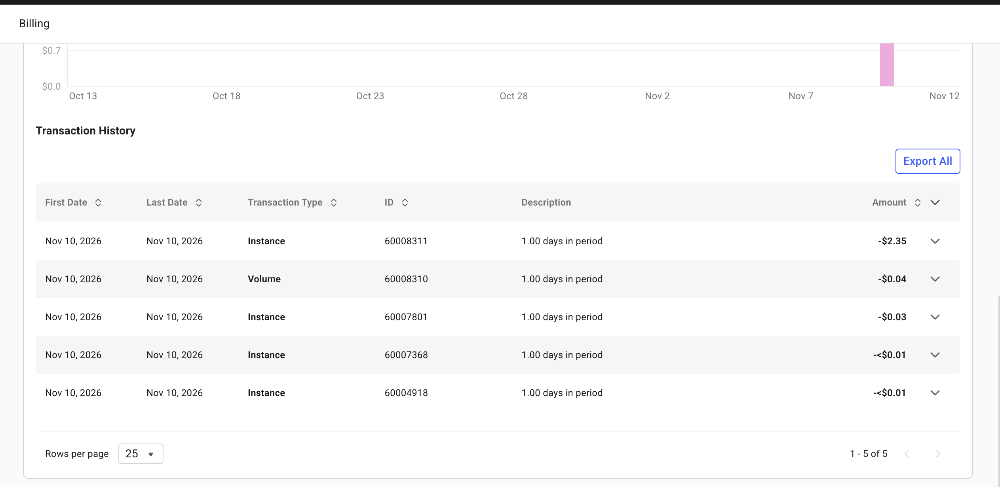
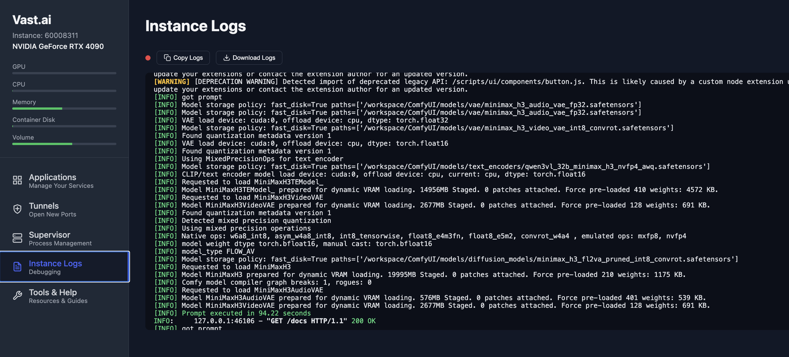
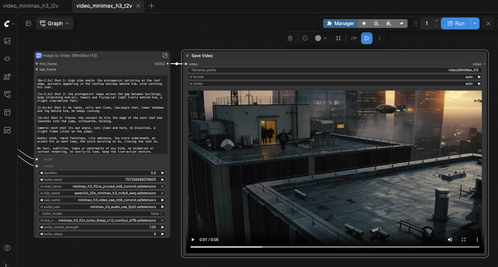
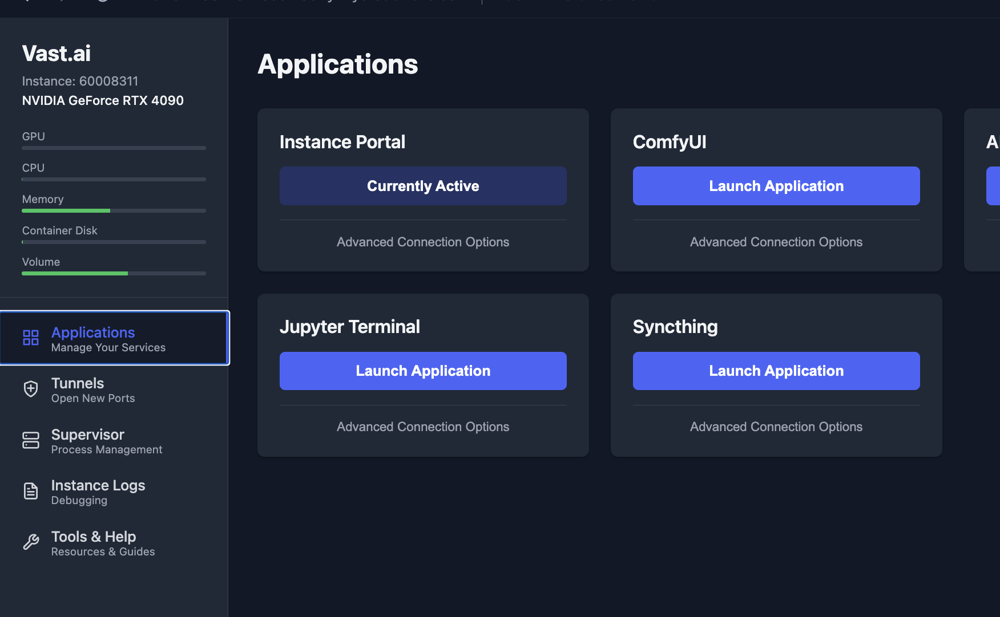
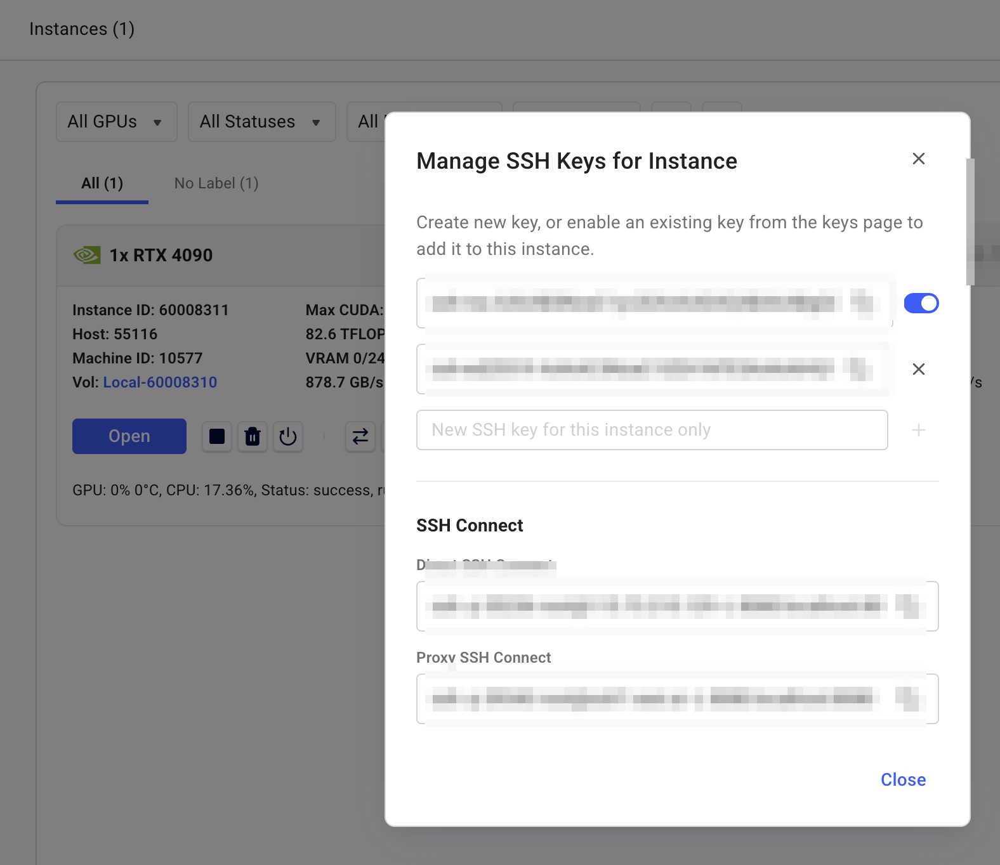
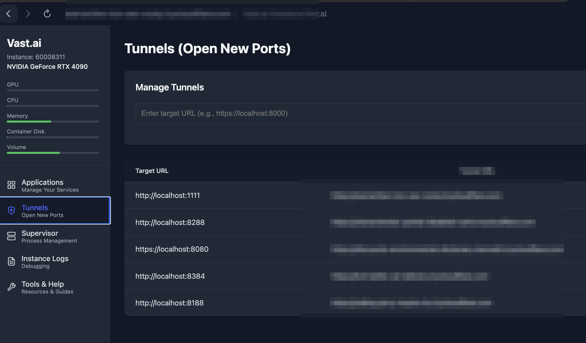
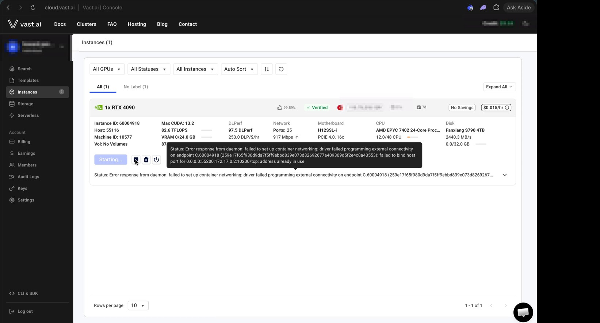

選做 A：[官方 M3／H3 API 圖文分鏡流水線](https://github.com/howardpen9/minimax-m3-h3-pipeline)
# MiniMax H3 自租部署证据（2026-11-10）

## 目的

本仓库是 2026-11-10 在 Vast.ai RTX 4090 上自租部署 MiniMax-H3 的公开证据库，用来配合邮件里提交的方案正文。仓库只放可复核的脚本、工作流、成片、账单和截图，不放方案正文，也不提供在线测试地址。

部署路径是 Vast Comfy 模板（容器）加上 [Comfy-Org/MiniMax-H3](https://github.com/Comfy-Org/MiniMax-H3) 量化权重，在实例本机 `http://127.0.0.1:18188` 调用 Comfy API。这与 MiniMax 官方 API 或 SGLang BF16 不是同一条路径。

实例 `60008311` 已 Destroy。本仓库不含隧道网址、SSH 私钥、公网 IP 或 Jupyter token，也不托管权重文件。SSH、Tunnels 和 11:08 录屏以打码版本收录，未打码原件未上传。

## 仓库结构

```
callable/      可调用方式：对本机 18188 端口的 Comfy API 脚本，以及冷首片 I2V 工作流 JSON
evidence/      启动报告、费用表、热机墙钟记录、11:08 启动失败打码录屏
outputs/       两则成片 mp4
screenshots/   公开截图、成片预览，以及已打码的 SSH / Tunnels / 失败录屏预览
```

| 路径 | 说明 |
| --- | --- |
| [`callable/h3-comfy-api-example.sh`](callable/h3-comfy-api-example.sh) | `/system_stats`、`POST /prompt`、`/queue`，并说明如何查询 `/history/<PROMPT_ID>` |
| [`callable/h3-i2v-first-prompt.json`](callable/h3-i2v-first-prompt.json) | 与冷首片相同的 I2V 工作流（640×640、5 秒、Turbo 关闭） |
| [`evidence/h3-bootstrap-report-60008311.txt`](evidence/h3-bootstrap-report-60008311.txt) | 启动报告：ComfyUI 0.43.0、RTX 4090、显存 24564 MiB、五档权重 |
| [`evidence/h3-cost-table-2026-11-10.md`](evidence/h3-cost-table-2026-11-10.md) | 费用表，账上可见合计 $2.44 |
| [`evidence/h3-warm-x3-times.md`](evidence/h3-warm-x3-times.md) | 冷首片 94.22 秒，热机三次平均 87.29 秒 |
| [`evidence/2026-11-10-1108-start-failed-redacted.mp4`](evidence/2026-11-10-1108-start-failed-redacted.mp4) | 实例 `60004918` 启动失败短录屏（已打码） |
| [`outputs/MiniMax_H3_00001_.mp4`](outputs/MiniMax_H3_00001_.mp4) | 主线 I2V，640×640，5.17 秒，24fps，AAC |
| [`outputs/MiniMax_H3_00002_.mp4`](outputs/MiniMax_H3_00002_.mp4) | 官方模板短 T2V 旁路，864×480，不当主线对照 |

本次实测没有另存 `POST /prompt` 返回的 `prompt_id` 或 `/history` JSON。`evidence/h3-warm-x3-times.md` 中的 JobID 是当时记录的墙钟任务编号，尚未核对其是否等于 Comfy `prompt_id`。两则成片 mp4 内嵌了完整 workflow JSON（workflow id `e3f2b845-8f2c-4b5a-9caf-eac1029d3e7e`），seed 为 `757358688076805`。

官方首帧素材（未重新托管）：[transparent_rgb_gaming_mouse.png](https://raw.githubusercontent.com/Comfy-Org/workflow_templates/refs/heads/main/input/transparent_rgb_gaming_mouse.png)

主线分辨率是 640×640，不能与官方 H3 768P 直接当成同一产品比价。

## 截图与成片

截图都放在 [`screenshots/`](screenshots/) 目录。账单和 94.22 秒实例日志已裁切。SSH 密钥页、Tunnels 页和 11:08 录屏已对敏感信息打码。

### 最终账单（合计 $2.44）

2026-11-12 的 Vast Transaction History，页面为 1-5 of 5，期间皆标 Nov 10, 2026。已裁掉账户侧栏。主实例 `60008311` 为 $2.35，其中下载 49.7GB 为 $1.94。



### 冷首片墙钟（94.22 秒）

实例 `60008311` 的 Instance Logs：`Prompt executed in 94.22 seconds`。已裁掉无关区域，日志里出现的是本机 `127.0.0.1`。



### 主线 I2V 成片

[`outputs/MiniMax_H3_00001_.mp4`](outputs/MiniMax_H3_00001_.mp4)（640×640，5.17 秒）。预览为成片约第 1 秒画面。

[](outputs/MiniMax_H3_00001_.mp4)

### 官方模板短 T2V 旁路（不当主线对照）

[`outputs/MiniMax_H3_00002_.mp4`](outputs/MiniMax_H3_00002_.mp4)（864×480，5.17 秒）。预览为成片约第 1 秒画面。12:03 截图是 Comfy 里播放该片时的界面，12:10 截图是官方模板库里的 MiniMax H3 模板。

[](outputs/MiniMax_H3_00002_.mp4)




### 实例应用页

2026-11-10 12:44 的 Vast Applications 页，可见实例 `60008311`、RTX 4090，以及模板自带的 Instance Portal、ComfyUI、Jupyter Terminal。不含隧道网址。



### SSH 密钥页（已打码）

2026-11-10 11:35，实例 `60008311` 的 SSH Keys 页。公钥、直连和代理 SSH 命令，以及画面右侧露出的公网 IP 已打码。实例号、机型和 Volume 仍可见。



### Tunnels 页（已打码）

2026-11-10 12:44。浏览器标题中的隧道主机名和 Tunnel URL 列已打码。本机 Target URL（localhost 端口）和实例号仍可见。



### 11:08 启动失败录屏（已打码）

实例 `60004918` 启动失败的短录屏，约 26 秒。失败信息是容器网络未能建立（driver failed programming external connectivity），不是端口被占。帐号显示名、账户余额和公网 IP 已逐帧打码。原始未打码录屏未上传。

预览为展开错误说明时的一帧。完整打码录屏见 [`evidence/2026-11-10-1108-start-failed-redacted.mp4`](evidence/2026-11-10-1108-start-failed-redacted.mp4)。

[](evidence/2026-11-10-1108-start-failed-redacted.mp4)
